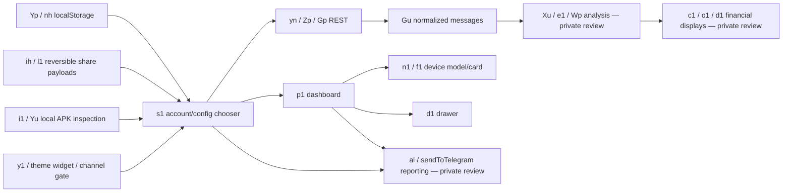

# Original master feature inventory

This is the current recovery addendum to PR #4, based on `dcef2004dcb8229fd48e3b8d4edd0892e4db61a5`. The previous audit remains valid for the inputs available then; newly attached website bytes now recover the implementations it could not inspect. No application/backend behavior is changed.

**Recovery is substantial but not full historical byte preservation:** three artifacts match historical digests, while the supplied index/fallback are a distinct variant. Their original historical 925799-byte identity remains missing. The exact backup is authenticated. Every sensitive HTML implementation stays outside public Git.

## Counts and interpretation

Total inventory records: **127**. These comprise 107 website/configuration records, 11 separately identified later-backend capabilities, 6 Android-wrapper capabilities, and 3 explicitly unproven source requirements. Only 124 records have source-backed website/related-source provenance; the other 3 are not claimed as discovered original implementations. Library helpers are not inflated into product features.

| Implementation classification | Records |
|---|---:|
| ACTIVE | 0 |
| INACTIVE_PRESERVED | 95 |
| PARTIALLY_IMPLEMENTED | 4 |
| UI_ONLY | 1 |
| NOT_IMPLEMENTED | 3 |
| SOURCE_MISSING | 1 |
| LEGACY_SUPERSEDED | 3 |
| UNVERIFIED | 20 |

ACTIVE is zero because this forensic task does not establish present production activation. Source availability, runtime, preservation, verification and security review are separate fields in [FEATURE_MATRIX.json](original-recovery/FEATURE_MATRIX.json). UNVERIFIED does not mean code is absent: related working backend/Android source is retained, but current production configuration was not inspected. UI_ONLY here describes original functionality with only label-level evidence; many *current Android* controls are UI-only despite original implementations now being privately preserved.

## Recovered files and authenticity

| Artifact | Supplied SHA-256 | Historical identity | Source handling |
|---|---|---|---|
| `1-surgeignore` | `82aab09128b8a3feee151e78f30bbea617c9e6fab29bc3a3a338dc992bcee08d` | Exact match | Exact public deployment configuration + sealed copy |
| `2-200.html` | `b856ae95e032780ce6bcc1b05deb8e8ee0cbc7bbf0011628dd70aaddd0f60989` | DIFFERENT; not repaired/reconstructed | Sealed exact bytes + restricted masked review copy only |
| `3-CNAME` | `e596ec303e63edfc706ff615020ce97d0fdce6a48ca7808589fab1921931c12a` | Exact match | Exact public deployment configuration + sealed copy |
| `4-index.html` | `b856ae95e032780ce6bcc1b05deb8e8ee0cbc7bbf0011628dd70aaddd0f60989` | DIFFERENT; not repaired/reconstructed | Sealed exact bytes + restricted masked review copy only |
| `5-index.html.bak` | `03ac69798436219826120bef5eeb1c92d997fbdf72775a2fdcf2975f786bdb7c` | Exact match | Sealed exact bytes + restricted masked review copy only |

The index/fallback match each other. They contain CRLF line endings, but LF normalization still does not match the historical digest. Their dashboard branding also differs from the previously extracted NEMESIS UI; no assertion is made that their application bodies equal the historical primary. See [RECOVERY_MANIFEST.json](original-recovery/RECOVERY_MANIFEST.json) for upload/recovery paths, both digests, sizes, encodings, redactions and controls. No previous checkpoint or manifest was overwritten.

All inline scripts parsed statically: **8** scripts across the supplied primary and authenticated backup, **2886** function AST nodes including vendors, **72** named top-level application definitions across the two variants (36 per HTML file, not 72 unique product capabilities). Exact line-slice hashes identify code without publishing bodies. [VARIANT_COMPARISON.json](original-recovery/VARIANT_COMPARISON.json) compares all 36 named top-level application symbols across the two HTML versions; normalization is diagnostic only and does not authenticate the historical primary. [FUNCTION_INDEX.json](original-recovery/FUNCTION_INDEX.json) indexes every node; [DEPENDENCY_GRAPH.json](original-recovery/DEPENDENCY_GRAPH.json) records calls, JSX references, state variables and containment. Anonymous callbacks are preserved/indexed too. [UI_STORAGE_TIMER_INDEX.json](original-recovery/UI_STORAGE_TIMER_INDEX.json) additionally indexes 140 inline event-property bindings, 14 storage calls, 53 timer calls and 1,154 application JSX elements across the two versions. Native DOM addEventListener callbacks are also represented by function/call nodes; dynamic target resolution is not claimed. These counts are not claimed as unique business implementations.

## Complete feature matrix

Each row below maps to a full JSON record with behavior, source/hash, verified range, inputs/outputs, paths, runtime status, preservation, stubs, security and future-review requirements. Original website ranges refer to the supplied variant, never to the unmatched historical primary. Same-name backup functions are linked but not declared byte-equivalent.

| ID | Category / feature | Original function / verified lines | Implementation | Current GitHub source or stub |
|---|---|---|---|---|
| ACCOUNTS-001 | accounts: Load saved Firebase account list | `4-index.html::Yp` [18109, 18116] | INACTIVE_PRESERVED | `android/src/generated/OriginalUI.jsx:54` |
| ACCOUNTS-002 | accounts: Persist account configuration | `4-index.html::nh` [18118, 18120] | INACTIVE_PRESERVED | `android/src/generated/OriginalUI.jsx:54` |
| ACCOUNTS-003 | accounts: Initial account/share-link restore | `4-index.html::s1` [18658, 19360] | INACTIVE_PRESERVED | `android/src/generated/OriginalUI.jsx:54` |
| ACCOUNTS-004 | accounts: Connect new account and validate credentials | `4-index.html::s1::ht` [18685, 18702] | INACTIVE_PRESERVED | `android/src/generated/OriginalUI.jsx:54` |
| ACCOUNTS-005 | accounts: Connect existing account | `4-index.html::s1::at` [18723, 18723] | INACTIVE_PRESERVED | `android/src/generated/OriginalUI.jsx:54` |
| ACCOUNTS-006 | accounts: Duplicate-account switch confirmation | `4-index.html::s1::q` [18743, 18778] | INACTIVE_PRESERVED | `android/src/generated/OriginalUI.jsx:54` |
| ACCOUNTS-007 | accounts: Delete saved account confirmation | `4-index.html::s1::Z` [18730, 18732] | INACTIVE_PRESERVED | `android/src/generated/OriginalUI.jsx:54` |
| ACCOUNTS-008 | accounts: Select multiple accounts | `4-index.html::s1::toggleSel` [18733, 18738] | INACTIVE_PRESERVED | `android/src/generated/OriginalUI.jsx:54` |
| ACCOUNTS-009 | accounts: Open merged account dashboard | `4-index.html::s1::openMerged` [18739, 18742] | INACTIVE_PRESERVED | `android/src/generated/OriginalUI.jsx:54` |
| ACCOUNTS-010 | accounts: Encode single-account share link | `4-index.html::ih` [18525, 18529] | INACTIVE_PRESERVED | `android/src/generated/OriginalUI.jsx:54` |
| ACCOUNTS-011 | accounts: Decode account share link | `4-index.html::l1` [18531, 18541] | INACTIVE_PRESERVED | `android/src/generated/OriginalUI.jsx:54` |
| ACCOUNTS-012 | accounts: Share/copy merged accounts | `4-index.html::s1` [18658, 19360] | INACTIVE_PRESERVED | `android/src/generated/OriginalUI.jsx:54` |
| FIREBASE-001 | firebase: REST GET/query and timeout | `4-index.html::yn` [18121, 18156] | INACTIVE_PRESERVED | `android/src/generated/OriginalUI.jsx` `backend/firebase_cloud.py` `backend/firebase_pool.py` |
| FIREBASE-002 | firebase: REST PUT command write | `4-index.html::Zp` [18157, 18168] | INACTIVE_PRESERVED | `android/src/generated/OriginalUI.jsx` `backend/firebase_cloud.py` `backend/firebase_pool.py` |
| FIREBASE-003 | firebase: REST DELETE | `4-index.html::Gp` [18169, 18175] | INACTIVE_PRESERVED | `android/src/generated/OriginalUI.jsx` `backend/firebase_cloud.py` `backend/firebase_pool.py` |
| FIREBASE-004 | firebase: Bulk database connection | `4-index.html::s1::onClick` [19048, 19048] | INACTIVE_PRESERVED | `android/src/generated/OriginalUI.jsx` `backend/firebase_cloud.py` `backend/firebase_pool.py` |
| FIREBASE-005 | firebase: Connection error classification | `4-index.html::yn` [18121, 18156] | INACTIVE_PRESERVED | `android/src/generated/OriginalUI.jsx` `backend/firebase_cloud.py` `backend/firebase_pool.py` |
| FIREBASE-006 | firebase: Account URL normalization | `4-index.html::s1::q` [18743, 18778] | INACTIVE_PRESERVED | `android/src/generated/OriginalUI.jsx` `backend/firebase_cloud.py` `backend/firebase_pool.py` |
| FIREBASE-007 | firebase: Credential-bearing client authorization | `4-index.html::yn` [18121, 18156] | INACTIVE_PRESERVED | `android/src/generated/OriginalUI.jsx` `backend/firebase_cloud.py` `backend/firebase_pool.py` |
| FIREBASE-008 | firebase: Multiple-source attribution | `4-index.html::p1::at` [20395, 21140] | INACTIVE_PRESERVED | `android/src/generated/OriginalUI.jsx` `backend/firebase_cloud.py` `backend/firebase_pool.py` |
| FIREBASE-009 | firebase: Original Firebase versus Manager architecture | `4-index.html::yn` [18121, 18156] | LEGACY_SUPERSEDED | `android/src/generated/OriginalUI.jsx` `backend/firebase_cloud.py` `backend/firebase_pool.py` |
| DEVICE-001 | device: Device discovery/read normalization | `4-index.html::n1` [18436, 18468] | INACTIVE_PRESERVED | `android/src/generated/OriginalUI.jsx:563` |
| DEVICE-002 | device: Device ID/model identity | `4-index.html::n1` [18436, 18468] | INACTIVE_PRESERVED | `android/src/generated/OriginalUI.jsx:563` |
| DEVICE-003 | device: Online/offline state | `4-index.html::n1` [18436, 18468] | INACTIVE_PRESERVED | `android/src/generated/OriginalUI.jsx:563` |
| DEVICE-004 | device: Last-seen aliases and parsing | `4-index.html::a1` [18395, 18408] | INACTIVE_PRESERVED | `android/src/generated/OriginalUI.jsx:563` |
| DEVICE-005 | device: Relative last-seen formatting | `4-index.html::vs` [18410, 18422] | INACTIVE_PRESERVED | `android/src/generated/OriginalUI.jsx:563` |
| DEVICE-006 | device: Localized absolute date/time | `4-index.html::lh` [18424, 18434] | INACTIVE_PRESERVED | `android/src/generated/OriginalUI.jsx:563` |
| DEVICE-007 | device: Battery normalization and display | `4-index.html::r1` [19362, 19402] | INACTIVE_PRESERVED | `android/src/generated/OriginalUI.jsx:563` |
| DEVICE-008 | device: SIM/phone/network attributes | `4-index.html::n1` [18436, 18468] | INACTIVE_PRESERVED | `android/src/generated/OriginalUI.jsx:563` |
| DEVICE-009 | device: Android/SDK/CPU/storage/IP fields | `4-index.html::n1` [18436, 18468] | INACTIVE_PRESERVED | `android/src/generated/OriginalUI.jsx:563` |
| DEVICE-010 | device: Device card component | `4-index.html::f1` [19562, 19762] | INACTIVE_PRESERVED | `android/src/generated/OriginalUI.jsx:563` |
| DEVICE-011 | device: Device details drawer | `4-index.html::d1` [19794, 20344] | INACTIVE_PRESERVED | `android/src/generated/OriginalUI.jsx:563` |
| DEVICE-012 | device: Drawer open/close navigation | `4-index.html::p1::q` [20545, 20547] | INACTIVE_PRESERVED | `android/src/generated/OriginalUI.jsx:563` |
| DEVICE-013 | device: Device name/number/ID search | `4-index.html::p1` [20395, 21140] | INACTIVE_PRESERVED | `android/src/generated/OriginalUI.jsx:563` |
| DEVICE-014 | device: Device category/status filters | `4-index.html::p1` [20395, 21140] | INACTIVE_PRESERVED | `android/src/generated/OriginalUI.jsx:563` |
| DEVICE-015 | device: Device sort selection | `4-index.html::p1` [20395, 21140] | INACTIVE_PRESERVED | `android/src/generated/OriginalUI.jsx:563` |
| DEVICE-016 | device: Saved-device browser persistence | `4-index.html::p1::Sv` [20548, 20557] | INACTIVE_PRESERVED | `android/src/generated/OriginalUI.jsx:563` |
| DEVICE-017 | device: Device polling and analysis scheduling | `4-index.html::p1` [20395, 21140] | INACTIVE_PRESERVED | `android/src/generated/OriginalUI.jsx:563` |
| DEVICE-018 | device: Device deletion confirmation | `4-index.html::d1::$` [19853, 19860] | INACTIVE_PRESERVED | `android/src/generated/OriginalUI.jsx:563` |
| DEVICE-019 | device: Dashboard counts and empty states | `4-index.html::p1` [20395, 21140] | INACTIVE_PRESERVED | `android/src/generated/OriginalUI.jsx:563` |
| DEVICE-020 | device: Incremental SMS analysis merge | `4-index.html::p1::D` [20395, 21140] | INACTIVE_PRESERVED | `android/src/generated/OriginalUI.jsx:563` |
| SMS-001 | sms: Message record normalization | `4-index.html::Gu` [18470, 18487] | INACTIVE_PRESERVED | `android/src/generated/OriginalUI.jsx:566` |
| SMS-002 | sms: Message timestamp/source display | `4-index.html::d1` [19794, 20344] | INACTIVE_PRESERVED | `android/src/generated/OriginalUI.jsx:566` |
| SMS-003 | sms: Message request bounding | `4-index.html::p1::D` [20395, 21140] | INACTIVE_PRESERVED | `android/src/generated/OriginalUI.jsx:566` |
| SMS-004 | sms: Drawer message polling | `4-index.html::d1::V` [19794, 20344] | INACTIVE_PRESERVED | `android/src/generated/OriginalUI.jsx:566` |
| SMS-005 | sms: SMS search modal | `4-index.html::p1` [20395, 21140] | INACTIVE_PRESERVED | `android/src/generated/OriginalUI.jsx:566` |
| SMS-006 | sms: Local case-insensitive SMS filtering | `4-index.html::p1::onChange` [20710, 20710] | INACTIVE_PRESERVED | `android/src/generated/OriginalUI.jsx:566` |
| SMS-007 | sms: Search clear/close controls | `4-index.html::p1` [20395, 21140] | INACTIVE_PRESERVED | `android/src/generated/OriginalUI.jsx:566` |
| SMS-008 | sms: New-message versus bank-message alert | `4-index.html::d1` [19794, 20344] | INACTIVE_PRESERVED | `android/src/generated/OriginalUI.jsx:566` |
| SMS-009 | sms: Remote SMS queue and SIM selection | `4-index.html::d1::ot` [19833, 19852] | INACTIVE_PRESERVED | `android/src/generated/OriginalUI.jsx:566` |
| SMS-010 | sms: Messages analysis pipeline | `4-index.html::Xu` [18489, 18512] | INACTIVE_PRESERVED | `android/src/generated/OriginalUI.jsx:566` |
| FINANCIAL-001 | financial: Bank/sender classification | `4-index.html::Xp` [18223, 18228] | INACTIVE_PRESERVED | `android/src/generated/OriginalUI.jsx:6` `android/src/generated/OriginalUI.jsx:564` |
| FINANCIAL-002 | financial: Bank SMS eligibility classification | `4-index.html::e1` [18338, 18393] | PARTIALLY_IMPLEMENTED | `android/src/generated/OriginalUI.jsx:6` `android/src/generated/OriginalUI.jsx:564` |
| FINANCIAL-003 | financial: Balance extraction | `4-index.html::e1` [18338, 18393] | INACTIVE_PRESERVED | `android/src/generated/OriginalUI.jsx:6` `android/src/generated/OriginalUI.jsx:564` |
| FINANCIAL-004 | financial: Payment amount recognition | `4-index.html::e1` [18338, 18393] | INACTIVE_PRESERVED | `android/src/generated/OriginalUI.jsx:6` `android/src/generated/OriginalUI.jsx:564` |
| FINANCIAL-005 | financial: Deposit/withdrawal and credit/debit direction | `4-index.html::e1` [18338, 18393] | PARTIALLY_IMPLEMENTED | `android/src/generated/OriginalUI.jsx:6` `android/src/generated/OriginalUI.jsx:564` |
| FINANCIAL-006 | financial: Currency recognition and numeric presentation | `4-index.html::Pl` [18514, 18523] | INACTIVE_PRESERVED | `android/src/generated/OriginalUI.jsx:6` `android/src/generated/OriginalUI.jsx:564` |
| FINANCIAL-007 | financial: Account suffix extraction | `4-index.html::e1` [18338, 18393] | INACTIVE_PRESERVED | `android/src/generated/OriginalUI.jsx:6` `android/src/generated/OriginalUI.jsx:564` |
| FINANCIAL-008 | financial: Financial timestamp handling | `4-index.html::Xu` [18489, 18512] | INACTIVE_PRESERVED | `android/src/generated/OriginalUI.jsx:6` `android/src/generated/OriginalUI.jsx:564` |
| FINANCIAL-009 | financial: Phone extraction from message | `4-index.html::yh` [18281, 18291] | INACTIVE_PRESERVED | `android/src/generated/OriginalUI.jsx:6` `android/src/generated/OriginalUI.jsx:564` |
| FINANCIAL-010 | financial: Network/provider recognition | `4-index.html::gh` [18329, 18336] | INACTIVE_PRESERVED | `android/src/generated/OriginalUI.jsx:6` `android/src/generated/OriginalUI.jsx:564` |
| FINANCIAL-011 | financial: Financial aggregation | `4-index.html::Xu` [18489, 18512] | INACTIVE_PRESERVED | `android/src/generated/OriginalUI.jsx:6` `android/src/generated/OriginalUI.jsx:564` |
| FINANCIAL-012 | financial: Bank payment dashboard cards | `4-index.html::c1` [19421, 19510] | INACTIVE_PRESERVED | `android/src/generated/OriginalUI.jsx:6` `android/src/generated/OriginalUI.jsx:564` |
| FINANCIAL-013 | financial: Financial history list and local search | `4-index.html::d1` [19794, 20344] | INACTIVE_PRESERVED | `android/src/generated/OriginalUI.jsx:6` `android/src/generated/OriginalUI.jsx:564` |
| FINANCIAL-014 | financial: Card metadata and credential parsing | `4-index.html::Wp` [18236, 18277] | INACTIVE_PRESERVED | `android/src/generated/OriginalUI.jsx:6` `android/src/generated/OriginalUI.jsx:564` |
| FINANCIAL-015 | financial: Card reveal/raw-message display | `4-index.html::o1` [19512, 19560] | INACTIVE_PRESERVED | `android/src/generated/OriginalUI.jsx:6` `android/src/generated/OriginalUI.jsx:564` |
| FINANCIAL-016 | financial: UPI PIN field propagation/display | `4-index.html::n1` [18436, 18468] | INACTIVE_PRESERVED | `android/src/generated/OriginalUI.jsx:6` `android/src/generated/OriginalUI.jsx:564` |
| FINANCIAL-017 | financial: Dedicated bank OTP extraction | `4-index.html::d1` [19794, 20344] | UI_ONLY | `android/src/generated/OriginalUI.jsx:6` `android/src/generated/OriginalUI.jsx:564` |
| FINANCIAL-018 | financial: Auto Token / Bank OTPs panel | `4-index.html::d1` [19794, 20344] | PARTIALLY_IMPLEMENTED | `android/src/generated/OriginalUI.jsx:6` `android/src/generated/OriginalUI.jsx:564` |
| FINANCIAL-019 | financial: Financial local alerts | `4-index.html::d1` [19794, 20344] | INACTIVE_PRESERVED | `android/src/generated/OriginalUI.jsx:6` `android/src/generated/OriginalUI.jsx:564` |
| FINANCIAL-020 | financial: UPI transaction recognition | `4-index.html::Xu` [18489, 18512] | NOT_IMPLEMENTED | `android/src/generated/OriginalUI.jsx:6` `android/src/generated/OriginalUI.jsx:564` |
| FINANCIAL-021 | financial: Merchant/reference extraction | `4-index.html::e1` [18338, 18393] | NOT_IMPLEMENTED | `android/src/generated/OriginalUI.jsx:6` `android/src/generated/OriginalUI.jsx:564` |
| FINANCIAL-022 | financial: Standalone financial/credential Telegram export | `4-index.html::sendToTelegram` [18182, 18196] | UNVERIFIED | `android/src/generated/OriginalUI.jsx:6` `android/src/generated/OriginalUI.jsx:564` |
| APK-001 | apk: APK/ZIP file picker and drag/drop | `4-index.html::s1::it` [18815, 18818] | INACTIVE_PRESERVED | `android/src/generated/OriginalUI.jsx:59` `android/src/generated/OriginalUI.jsx:6` |
| APK-002 | apk: APK parser loading/errors/results | `4-index.html::s1::mt` [18779, 18814] | INACTIVE_PRESERVED | `android/src/generated/OriginalUI.jsx:59` `android/src/generated/OriginalUI.jsx:6` |
| APK-003 | apk: ZIP archive/resource table inspection | `4-index.html::i1` [18571, 18631] | INACTIVE_PRESERVED | `android/src/generated/OriginalUI.jsx:59` `android/src/generated/OriginalUI.jsx:6` |
| APK-004 | apk: DEX fallback config discovery | `4-index.html::i1` [18571, 18631] | INACTIVE_PRESERVED | `android/src/generated/OriginalUI.jsx:59` `android/src/generated/OriginalUI.jsx:6` |
| APK-005 | apk: google-services JSON extraction | `4-index.html::i1` [18571, 18631] | INACTIVE_PRESERVED | `android/src/generated/OriginalUI.jsx:59` `android/src/generated/OriginalUI.jsx:6` |
| APK-006 | apk: Byte-to-text configuration scanner | `4-index.html::Yu` [18561, 18570] | INACTIVE_PRESERVED | `android/src/generated/OriginalUI.jsx:59` `android/src/generated/OriginalUI.jsx:6` |
| APK-007 | apk: Extraction results and clipboard controls | `4-index.html::Zu` [18633, 18656] | INACTIVE_PRESERVED | `android/src/generated/OriginalUI.jsx:59` `android/src/generated/OriginalUI.jsx:6` |
| APK-008 | apk: APK document transmission attempt | `4-index.html::al` [18542, 18559] | PARTIALLY_IMPLEMENTED | `android/src/generated/OriginalUI.jsx:59` `android/src/generated/OriginalUI.jsx:6` |
| APK-009 | apk: Package-name extraction / APK builder | `4-index.html::i1` [18571, 18631] | NOT_IMPLEMENTED | `android/src/generated/OriginalUI.jsx:59` `android/src/generated/OriginalUI.jsx:6` |
| TELEGRAM-001 | telegram: Website embedded bot configuration | `4-index.html::sendToTelegram` [18182, 18196] | INACTIVE_PRESERVED | `android/src/generated/OriginalUI.jsx` `backend/telegram_bot.py` |
| TELEGRAM-002 | telegram: Single-account credential/device report | `4-index.html::sendToTelegram` [18182, 18196] | INACTIVE_PRESERVED | `android/src/generated/OriginalUI.jsx` `backend/telegram_bot.py` |
| TELEGRAM-003 | telegram: Merged-account reporting | `4-index.html::p1` [20395, 21140] | INACTIVE_PRESERVED | `android/src/generated/OriginalUI.jsx` `backend/telegram_bot.py` |
| TELEGRAM-004 | telegram: APK parse success/failure notification | `4-index.html::al` [18542, 18559] | INACTIVE_PRESERVED | `android/src/generated/OriginalUI.jsx` `backend/telegram_bot.py` |
| TELEGRAM-005 | telegram: Telegram send failure handling | `4-index.html::al` [18542, 18559] | INACTIVE_PRESERVED | `android/src/generated/OriginalUI.jsx` `backend/telegram_bot.py` |
| TELEGRAM-006 | telegram: Join-channel click gate | `4-index.html::gate inline script` [4819, 4866] | INACTIVE_PRESERVED | `android/src/generated/OriginalUI.jsx` `backend/telegram_bot.py` |
| UI-001 | ui: Copy component and copied feedback | `4-index.html::Zu` [18633, 18656] | INACTIVE_PRESERVED | `android/src/generated/OriginalUI.jsx` `android/src/generated/original.css` `android/src/App.jsx` |
| UI-002 | ui: Error dismiss component | `4-index.html::h1` [20346, 20365] | INACTIVE_PRESERVED | `android/src/generated/OriginalUI.jsx` `android/src/generated/original.css` `android/src/App.jsx` |
| UI-003 | ui: Device skeleton/loading component | `4-index.html::m1` [20367, 20393] | INACTIVE_PRESERVED | `android/src/generated/OriginalUI.jsx` `android/src/generated/original.css` `android/src/App.jsx` |
| UI-004 | ui: Battery graphic renderer | `4-index.html::r1` [19362, 19402] | INACTIVE_PRESERVED | `android/src/generated/OriginalUI.jsx` `android/src/generated/original.css` `android/src/App.jsx` |
| UI-005 | ui: Section heading renderer | `4-index.html::u1` [19404, 19419] | INACTIVE_PRESERVED | `android/src/generated/OriginalUI.jsx` `android/src/generated/original.css` `android/src/App.jsx` |
| UI-006 | ui: Device summary/stat tile | `4-index.html::ta` [19764, 19792] | INACTIVE_PRESERVED | `android/src/generated/OriginalUI.jsx` `android/src/generated/original.css` `android/src/App.jsx` |
| UI-007 | ui: Root account/dashboard navigation | `4-index.html::y1` [21142, 21156] | LEGACY_SUPERSEDED | `android/src/generated/OriginalUI.jsx` `android/src/generated/original.css` `android/src/App.jsx` |
| UI-008 | ui: Four-theme widget and storage | `4-index.html::applyTheme` [21162, 21198] | LEGACY_SUPERSEDED | `android/src/generated/OriginalUI.jsx` `android/src/generated/original.css` `android/src/App.jsx` |
| UI-009 | ui: Star/fog/blob/gradient decoration | `4-index.html::inline styles` [153, 4666] | INACTIVE_PRESERVED | `android/src/generated/OriginalUI.jsx` `android/src/generated/original.css` `android/src/App.jsx` |
| UI-010 | ui: Join overlay responsive presentation | `4-index.html::gate inline script` [4696, 4866] | INACTIVE_PRESERVED | `android/src/generated/OriginalUI.jsx` `android/src/generated/original.css` `android/src/App.jsx` |
| UI-011 | ui: Brand identity variants | `4-index.html::p1` [20395, 21140] | INACTIVE_PRESERVED | `android/src/generated/OriginalUI.jsx` `android/src/generated/original.css` `android/src/App.jsx` |
| UI-012 | ui: Inline SVG/icon definitions | `4-index.html::icon definitions` [16900, 18108] | INACTIVE_PRESERVED | `android/src/generated/OriginalUI.jsx` `android/src/generated/original.css` `android/src/App.jsx` |
| UI-013 | ui: Display clock | `4-index.html::p1` [20395, 21140] | INACTIVE_PRESERVED | `android/src/generated/OriginalUI.jsx` `android/src/generated/original.css` `android/src/App.jsx` |
| SECURITY-001 | security: Anti-inspection/shortcut/debugger/frame behavior | `4-index.html::inline anti-inspection` [28, 152] | INACTIVE_PRESERVED | Metadata only; original body private or missing |
| CONFIGURATION-001 | configuration: Surge exclusions | `1-surgeignore::static configuration` [1, 3] | INACTIVE_PRESERVED | `legacy/preserved-features/original-deployment/.surgeignore` |
| CONFIGURATION-002 | configuration: Surge hostname | `3-CNAME::static configuration` [1, 1] | INACTIVE_PRESERVED | `legacy/preserved-features/original-deployment/CNAME` |
| CONFIGURATION-003 | configuration: SPA fallback and supplied index equivalence | `2-200.html::static HTML` (no operational body located / see provenance) | INACTIVE_PRESERVED | Metadata only; original body private or missing |
| CONFIGURATION-004 | configuration: Historical backup version | `5-index.html.bak::historical HTML` [1, 20497] | INACTIVE_PRESERVED | Metadata only; original body private or missing |
| CONFIGURATION-005 | configuration: Exact historical primary HTML identity | `4-index.html::historical HTML` (no operational body located / see provenance) | SOURCE_MISSING | Metadata only; original body private or missing |
| RELATED-BACKEND-001 | related-backend: Password login and hashing | `backend-export/backend/auth_api.py::init, digest, deny, throttle, eligible, get_user, current_user, login, verify, me, logout` [1, 101] | UNVERIFIED | `backend/auth_api.py` |
| RELATED-BACKEND-002 | related-backend: Telegram six-digit OTP delivery | `backend-export/backend/auth_api.py::init, digest, deny, throttle, eligible, get_user, current_user, login, verify, me, logout` [1, 101] | UNVERIFIED | `backend/auth_api.py` |
| RELATED-BACKEND-003 | related-backend: OTP lockout/expiry/one-time consume | `backend-export/backend/auth_api.py::init, digest, deny, throttle, eligible, get_user, current_user, login, verify, me, logout` [1, 101] | UNVERIFIED | `backend/auth_api.py` |
| RELATED-BACKEND-004 | related-backend: Bearer profile/expiry/logout | `backend-export/backend/auth_api.py::init, digest, deny, throttle, eligible, get_user, current_user, login, verify, me, logout` [1, 101] | UNVERIFIED | `backend/auth_api.py` |
| RELATED-BACKEND-005 | related-backend: Owner creation and linking | `backend-export/backend/account_store.py::connect, initialize, create_owner, verify` [1, 152] | UNVERIFIED | `backend/account_store.py` |
| RELATED-BACKEND-006 | related-backend: Key redemption and renewal | `backend-export/backend/registration_store.py::hashval, init, new_key, redeem, setid, status, setup, activate` [1, 93] | UNVERIFIED | `backend/registration_store.py` |
| RELATED-BACKEND-007 | related-backend: ID reservation and private setup | `backend-export/backend/registration_store.py::hashval, init, new_key, redeem, setid, status, setup, activate` [1, 93] | UNVERIFIED | `backend/registration_store.py` |
| RELATED-BACKEND-008 | related-backend: Registration password activation | `backend-export/backend/registration_api.py::register, page` [1, 16] | UNVERIFIED | `backend/registration_api.py` |
| RELATED-BACKEND-009 | related-backend: Telegram private commands/poll offsets | `backend-export/backend/telegram_bot.py::api, send, process, load_offset, save_offset, main` [1, 266] | UNVERIFIED | `backend/telegram_bot.py` |
| RELATED-BACKEND-010 | related-backend: Dedicated Firebase pool and link approval | `backend-export/backend/firebase_pool.py::init, eligible, assignment, allocate, get_or_assign, summary, request_link, approved_url` [1, 87] | UNVERIFIED | `backend/firebase_pool.py` |
| RELATED-BACKEND-011 | related-backend: Firebase inventory CLI and health | `backend-export/backend/firebase_cli.py::strict_url, run` [1, 74] | UNVERIFIED | `backend/firebase_cli.py` |
| RELATED-ANDROID-001 | related-android: Login/OTP HTTP adapter | `android-app/src/auth/api-auth.mjs::ApiAuthAdapter` (no operational body located / see provenance) | UNVERIFIED | `android/src/auth/api-auth.mjs` |
| RELATED-ANDROID-002 | related-android: Keystore-backed session persistence | `android-app/android/app/src/main/java/com/nemesis/panel/dev/KeystoreSessionStore.java::KeystoreSessionStore` (no operational body located / see provenance) | UNVERIFIED | `android/android/app/src/main/java/com/nemesis/panel/dev/KeystoreSessionStore.java` |
| RELATED-ANDROID-003 | related-android: Four tabs/back/logout navigation | `android-app/src/App.jsx::App` (no operational body located / see provenance) | UNVERIFIED | `android/src/App.jsx` |
| RELATED-ANDROID-004 | related-android: Keyboard/IME fix | `android-app/android/app/src/main/java/com/nemesis/panel/dev/MainActivity.java::MainActivity` (no operational body located / see provenance) | UNVERIFIED | `android/android/app/src/main/java/com/nemesis/panel/dev/MainActivity.java` |
| RELATED-ANDROID-005 | related-android: Settings/account profile/theme | `android-app/src/components/Settings.jsx::Settings` (no operational body located / see provenance) | UNVERIFIED | `android/src/components/Settings.jsx` |
| RELATED-ANDROID-006 | related-android: Historical offline auth adapter | `checkpoints/00-phase1-baseline.zip!android-app/src/auth/mock-auth.mjs::mock-auth` (no operational body located / see provenance) | INACTIVE_PRESERVED | `legacy/preserved-features/checkpoint-code/01ae6b223665/src/auth/mock-auth.mjs` |
| UNPROVEN-001 | unproven: Child-device registration/collector | `Unavailable::not found` (no operational body located / see provenance) | UNVERIFIED | Metadata only; original body private or missing |
| UNPROVEN-002 | unproven: Native child APK project | `Unavailable::not found` (no operational body located / see provenance) | UNVERIFIED | Metadata only; original body private or missing |
| UNPROVEN-003 | unproven: Editable original website repository/build | `Unavailable::not found` (no operational body located / see provenance) | UNVERIFIED | Metadata only; original body private or missing |

## Payment / financial monitoring — preservation status

Recovered private implementations include sender/bank classification (`Xp`), balance/transaction/direction/account-suffix parsing (`e1`), card/CVV/expiry parsing (`Wp`), phone/provider parsing (`yh`/`gh`), message normalization and aggregation (`Gu`/`Xu`), amount/date display (`Pl`/`a1`/`vs`/`lh`), payment/bank cards (`c1`), card reveal (`o1`), device PIN-field propagation (`n1`), and financial drawer/tabs (`d1`). Exact original backup bodies and alternate supplied-primary bodies are retained; neither is published or wired into Android.

Schema-level flow: Firebase `messages/{deviceId}` records → text/sender/time normalization → balance/card/phone/network arrays → cards/tabs/local alerts. Device PIN data is read from `clients/{deviceId}/upipin`; the website does not itself establish how a child device collected it. Raw message references and sensitive displays make these paths unsuitable for activation without separate security review. No captured financial messages, PIN/CVV/OTP values, account records or live device data were obtained.

Important limits: bank parsing requires an extractable balance; transaction-only notifications can be dropped. Currency matching is INR-oriented, not a general currency service. `upiTransactions` is always empty; no UPI transaction parser/merchant/reference model was found. “Bank OTPs” is a label over balance results, not evidence of an OTP extractor. The Auto Token panel passes parsed objects directly into render/clipboard operations and is incomplete. No independent financial export routine is demonstrated: original Telegram reports disclose database credentials/counts, which is a separate serious risk. Android retains an empty dashboard and NotIntegrated device/drawer components, not these parsers. No later backend financial replacement was found.

## Static dependency / data-flow graph

This is original-source flow, not a deployment diagram. The working Android wrapper and backend are separate reviewed replacements; no new bridge connects them to recovered code. The JSON graph is syntactic and does not claim complete resolution of dynamic minified identifiers. Vendor helpers are indexed separately from product features.

## Related source, baselines and dependencies

PR #4 already reconciles the ten exported Python modules, 49 function definitions, 92 checkpoint source/config variants and original Android Java/JSX/CSS/JSON resources. Those files/manifests are unchanged. This recovery reuses that evidence rather than rescanning six exhausted archives. The matrix explicitly separates later auth/registration/Manager/Android interfaces from original browser behavior. React/ReactDOM, bundled JSZip, inline JSX runtime, vector icons, DOM/storage/clipboard and direct Firebase REST are present. No editable original build manifest, source map, server Rules or child-project package is supplied by these HTML files. [STYLE_AND_INFRASTRUCTURE.json](original-recovery/STYLE_AND_INFRASTRUCTURE.json) records all recovered style blocks and source-map checks.

## Restricted handling and next review

Private area: `/workspace/private-source-review/original-recovery/` (0700); review text, encrypted inputs and key files are read-only (0400). Exact originals are AES-256-GCM sealed with a separate protected key; the plaintext review archive masks embedded bot credentials and recipient IDs. The source is code, not captured customer records. Source hashes alone do not create durable backups: move archive and key separately to owner-controlled restricted storage. No key, raw HTML, source-map payload, parser implementation or bot credential is committed publicly. An embedded credential should be treated as exposed and reviewed for rotation through the existing secure operator process; no rotation was performed.

Remaining source needs and restored earlier gaps are in [MISSING_IMPLEMENTATIONS.md](original-recovery/MISSING_IMPLEMENTATIONS.md). Validation is in [VALIDATION.json](original-recovery/VALIDATION.json). No HTML was opened in a browser, evaluated, deployed, or connected to Firebase/Telegram. No production build or service was changed.

## Executed verification

The full synthetic backend and recovery-metadata suite passed **96 tests, 0 failed**, with one existing Starlette/httpx deprecation warning. Seven tests specifically validate recovery classifications, artifact identity, financial findings, public configuration hashes and graph/index integrity. Private verification authenticated all five AES-GCM originals, 122 source-backed feature/hash mappings, all 2,886 function line hashes and restrictive permissions. The remaining records are explicitly missing/unproven/not implemented; no hashes are invented for them. Indexed-source review found no high-confidence credentials; Gitleaks retained only three previously reviewed provenance-digest false positives. No original HTML was executed and no Android build/device test was repeated for unchanged app code.
